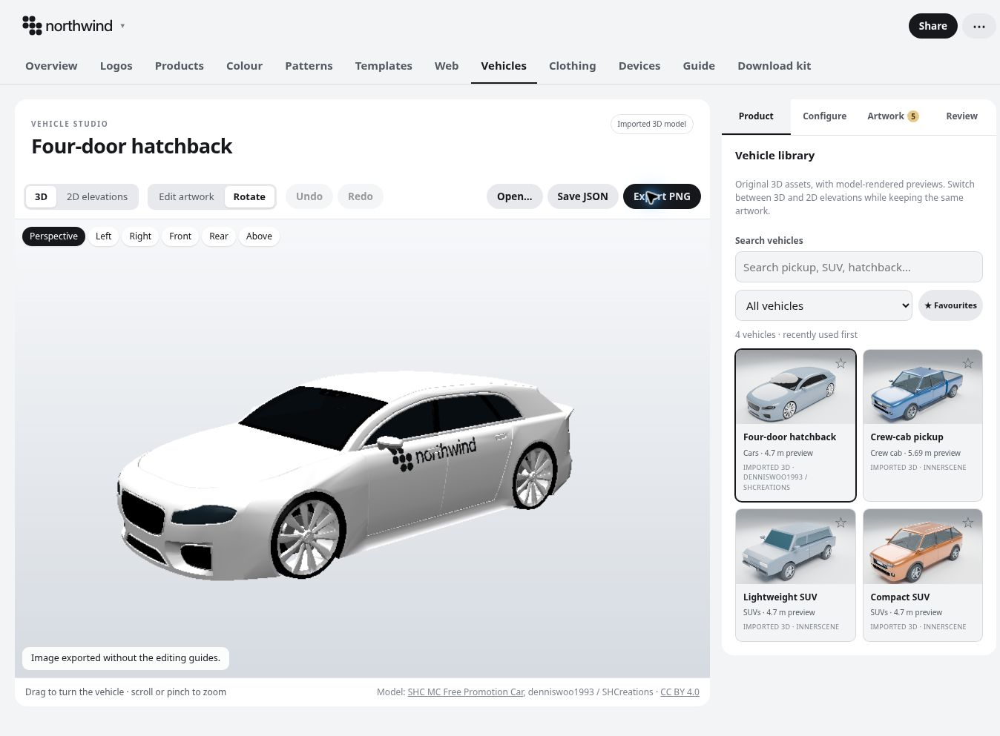
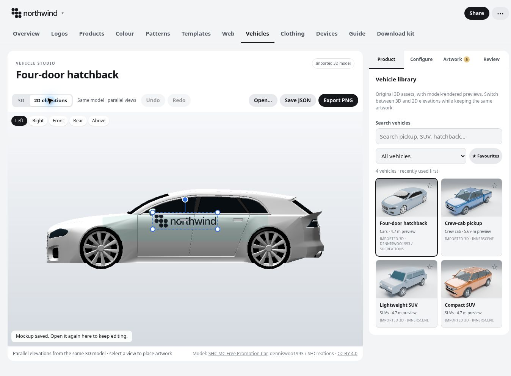
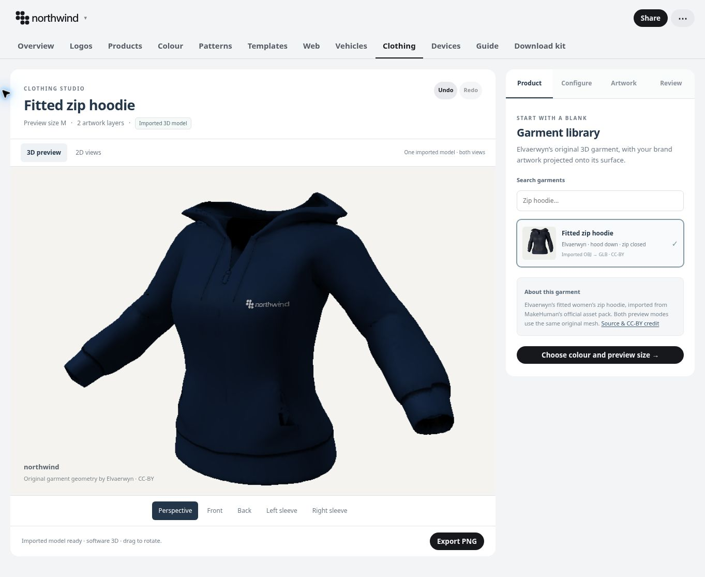

# Imported 3D vehicle and garment studios

**20 November 2026 — revised after the asset review**

The current implementation uses imported third-party model geometry. A rotatable 3D view and
flat orthographic elevations share the same loaded mesh, materials and artwork. The drawn
vehicle fallback, catalogue silhouettes and procedural clothing previews from the earlier
pilot have been removed. This folder replaces that pilot's screenshots and export evidence.

**Local verification: 259 tests passed, no failures or skips; production build passed.** Actual
managed-browser checks demonstrated the imported car and pickup in 3D, drag rotation, model-derived
2D elevations, original pickup cover components, imported hoodie artwork, PNG/JSON/review exports,
legacy garment recovery and narrow layouts. The browser uses the new **software 3D renderer**
because its WebGL context is disabled. These screenshots show actual projected mesh geometry.
They do not establish GPU/PBR rendering or physical-phone performance.

## See the result

### Imported car in 3D

The same car after dragging its orbit controls is recorded in [car-orbit.jpg](car-orbit.jpg).
Its source is the existing **SHC MC Free Promotion Car** by **denniswoo1993 / SHCreations**,
distributed under CC BY 4.0. The GLB retains its original source metadata. The app and exported
PNG include the creator and licence credit; see [vehicle model notices](../../../src/mockups/models/NOTICES.md).

### Matching 2D view from the same geometry

This view uses an orthographic camera looking at the same scene. It does not load an illustration
or substitute silhouette. Exported project JSON was identical before orbiting and after switching
to 2D, including original layer IDs, artwork references, dimensions and positions.

### Imported garment

The garment is **Elvaerwyn's fitted women's zip hoodie**, with the zip closed and hood down,
from the [official MakeHuman shirts02 pack](https://static.makehumancommunity.org/assets/assetpacks/shirts02.html).
The official pack and original metadata label it CC-BY without identifying a version. Its
[source files and hashes](../../../assets/apparel/elvaerwyn-zip-hoodie/SOURCE.json),
[conversion script](../../../scripts/convert-apparel-asset.py) and
[notices](../../../public/models/apparel/NOTICES.md) are included. No garment mesh was authored
for this revision. The original mesh is converted to metres, centred, triangulated and packaged
as GLB, with original UVs and texture maps retained.

## Available assets and scope

| New-design choice | Source geometry | Configuration |
| --- | --- | --- |
| Crew-cab pickup | Original Innerscene GLB, 146,508 triangles including cover | Open bed or its original retractable tonneau |
| Four-door hatchback | Existing SHCreations imported GLB, 42,035 triangles | Body paint, wrap and artwork |
| Lightweight SUV | Existing Innerscene imported GLB, 16,228 triangles | Body paint, wrap and artwork |
| Compact SUV | Existing Innerscene imported GLB, 126,758 triangles | Body paint, wrap and artwork |
| Fitted zip hoodie | Original Elvaerwyn OBJ converted to GLB, 19,574 triangles | Colour, illustrative scale, chest/back/sleeve artwork |

The pickup is an unbranded visualization asset, not an F-150 or Tacoma. The
[publisher's source page](https://www.innerscene.com/tools/library/3d-parts/crew-cab-pickup-with-tonneau-cover-059c14f0)
identifies it as an original Innerscene model under CC0. The checked-in GLB is the unchanged
download. Its exact SHA-256 is
`faa7a63c8cde051e41b3c90d3d9afc1afb25e60735f5b4508c401554eaa84fb2`.

Open mode hides exactly 19 existing cover nodes. It exposes the original bed floor, walls and
tailgate. Tonneau mode shows those same nodes again. Geometry, material and transform references
are unchanged by this configuration operation. A separate canopy candidate was rejected after
geometry inspection and rendering; no replacement canopy was fabricated for the imported pickup.

Older procedural canopy/service trucks remain addressable when reopening saved projects, and
their layers are retained when switching to imported models. They are absent from the new-design
catalogue. Their original brand lettering/wrap files remain available through Design selectors.

## How it is implemented

### One scene, two camera types

The vehicle studio loads a checksum-pinned GLB through `GLTFLoader`, normalises its orientation
and nominal display scale, and identifies paint surfaces by material role. The imported pickup
adapter validates its original cover nodes before changing visibility. The model's actual bounds
fit the perspective camera to the viewport; the parallel camera provides side/front/rear/above
elevations. Changing projection does not change the canonical vehicle project.

Artwork retains its original logo/upload source and proportions. `DecalGeometry` clips each
placement onto the imported paint mesh. The same decal geometry is visible in both camera modes.
Independent layers keep their model, component, placement, visibility, lock state and ordering.
An incompatible model or component makes a layer unplaced while preserving the original data.

### Rendering without substituting an asset

When WebGL is available, the existing Three.js renderer uses the scene's PBR materials. When
context creation fails, `model-preview.js` renders that same Three scene using a CPU triangle
rasterizer and Canvas2D. It implements depth occlusion, near-plane clipping, perspective-correct
UV sampling, original diffuse images, decal alpha and layer order. Orbit controls and raycasts
continue to act on the original geometry.

The software renderer limits interactive pixel work and renders full export dimensions on demand.
It uses simpler lighting; normal maps, environment reflections and shadow maps require WebGL.
It preserves the last rendered frame across canvas resizing, preventing an empty frame between
a resize event and the next scheduled scene render. Transparent shared edges use consistent
triangle coverage so artwork does not acquire dark diagonal seams.

### Source-derived catalogue and garment views

The vehicle catalogue uses images rendered from each exact GLB with
[`render-model-previews.py`](../../../scripts/render-model-previews.py). Each thumbnail has an
adjacent source manifest recording the GLB hash, camera projection, renderer and settings.
The script adds only a studio floor, lights and camera; it does not create vehicle geometry.

Clothing uses the original Elvaerwyn mesh. Its original dark-blue diffuse texture is desaturated
and exposed before applying a selected colour, preserving existing fabric detail. Artwork is
projected onto the original triangles, with chest areas clear of the central zip and back areas
below the hood. The size selector uniformly scales one reference mesh; it is not supplier grading.
Review sheets compose front and back orthographic renders from that same scene.

## Evidence and tests

| Check | Observed result |
| --- | --- |
| Full local test suite | **259 passed, 0 failed, 0 skipped** |
| Production build | Passed; existing bundle-size and dynamic-import warnings remain |
| Imported pickup integrity | Exact source checksum, original geometry, 19-node visibility-only cover toggle and exact restoration |
| Pickup artwork areas | **3,900 raycasts**: six source-mesh areas × 325 samples × both configurations; exposed outward paint, clear of glass, handles and plate recess |
| Software rendering | Geometry/depth, UV orientation, original textures, decal alpha/order, perspective versus orthographic projection, clipping, frustum fitting and resize preservation |
| Garment integrity | Original OBJ coordinates and UVs retained after conversion; actual model coverage across all preview scales; readable front/back artwork |
| Browser rotation | Actual canvas drag changed the car's visible side and depth; screenshots record both views |
| View consistency | Car JSON before orbit/2D and after switching to 2D matched exactly |
| Pickup configuration | Above-view screenshots show the original open bed and closed tonneau |
| Exports | Car/pickup PNGs **2400 × 1500**; hoodie PNG **1600 × 1400** in the observed stage; vehicle SVG embeds four distinct views, garment SVG two |
| Legacy garment recovery | Downloaded the original schema-1 saved record; opening it was rejected without replacing the current imported hoodie design |
| Narrow layout | 390 × 844 browser frame; both studios reported **375 px client width and 375 px scroll width**, with imported 3D models visible |

The updated Playwright browser runners were syntax-checked but **not executed** here. The
managed-browser journeys above are the actual browser evidence. Full WebGL browser runs,
representative GPU performance and physical-device touch testing remain separate qualification.
No supplier SKU, fitted canopy, cutting template or embroidery machine file is claimed.

See [browser-evidence.json](browser-evidence.json) for exported-file hashes and recorded checks,
and [local-validation.json](local-validation.json) for the local validation summary.

## Files to inspect or reopen

| Deliverable | Files |
| --- | --- |
| Car | [3D screenshot](car-3d.jpg), [rotated screenshot](car-orbit.jpg), [2D screenshot](car-2d.jpg), [2400 px PNG](car-3d.png), [project JSON](car-project.json) |
| Pickup | [3D screenshot](pickup-3d.jpg), [2D screenshot](pickup-2d-elevation.jpg), [open bed](pickup-open-above.jpg), [tonneau](pickup-tonneau-above.jpg), [PNG](pickup-3d.png), [project](pickup-project.json), [four-view review](pickup-review.svg) |
| Hoodie | [3D screenshot](hoodie-3d.jpg), [2D back screenshot](hoodie-2d-back.jpg), [back PNG](hoodie-back.png), [project](hoodie-project.json), [front/back review](hoodie-review.svg) |
| Narrow layout | [Car at 390 px](car-390px.jpg), [hoodie at 390 px](hoodie-390px.jpg) |
| Recovery | [Downloaded legacy garment project](legacy-hoodie-backup.json) |

## Implementation map

| Responsibility | Main files |
| --- | --- |
| Vehicle UI and catalogue | [`Vehicles.jsx`](../../../src/app/views/Vehicles.jsx), [`VehicleCatalog.jsx`](../../../src/mockups/VehicleCatalog.jsx) |
| Asset records and actual source cover | [`vehicle-models.js`](../../../src/mockups/vehicle-models.js), [`imported-pickup.js`](../../../src/mockups/imported-pickup.js) |
| Vehicle scene, projection and decals | [`vehicle-studio.js`](../../../src/mockups/vehicle-studio.js), [`vehicle-layout.js`](../../../src/mockups/vehicle-layout.js) |
| Shared software renderer | [`model-preview.js`](../../../src/mockups/model-preview.js) |
| Imported garment and artwork | [`apparel-garment.js`](../../../src/mockups/apparel-garment.js), [`apparel-studio.js`](../../../src/mockups/apparel-studio.js), [`apparel-layout.js`](../../../src/mockups/apparel-layout.js) |
| Model-derived garment review | [`apparel-review-sheet.js`](../../../src/mockups/apparel-review-sheet.js) |
| Saved projects and raw recovery | [`MockupProjects.jsx`](../../../src/mockups/MockupProjects.jsx), [`mockup-project-store.js`](../../../src/mockups/mockup-project-store.js), [`mockup-draft.js`](../../../src/mockups/mockup-draft.js) |

The branch uses `[skip ci]` commits. All recorded automated checks were run locally to avoid
consuming the GitHub Actions budget. This remains a draft PR for review and the remaining GPU
qualification; it has not been merged.
